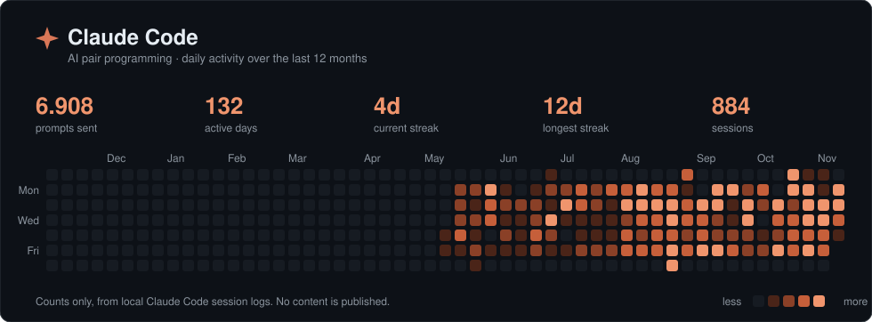

## Hi, I'm Gustavo 👋

I help companies turn manual processes into **automated workflows, data dashboards and custom applications** — cutting rework, eliminating errors and giving real-time visibility for decision-making.

My background is in financial operations: accounts payable and receivable, treasury and reconciliations. I hold a degree in Financial Management and currently work in Internal Controls, bringing that experience to **[Doganelli Automações](https://doganelliautomacoes.pages.dev)**, where I serve small and mid-sized businesses and finance teams. Based in São Paulo, Brazil — open to remote projects worldwide.

- 🔭 Currently working with **AI agents, RAG with pgvector, MCP servers** and agentic pipelines with human approval
- 🌱 Learning: **automated testing and CI/CD**
- 📚 In my spare time, philosophy: I built **[O Pórtico](https://github.com/gustadoganelli/portfolio/tree/main/portico)**, a daily study app with 7 tracks and 52 lessons

## What I do

- ⚙️ **Automation & integration** — n8n workflows, APIs and webhooks connecting systems, spreadsheets and email.
- 📊 **Business Intelligence** — Power BI dashboards, SQL and Python for month-end close, reconciliation and KPIs.
- 🌐 **Websites & applications** — from company websites to custom apps, with Next.js, Supabase and Cloudflare.
- 🤖 **Applied AI** — AI agents, LLM-powered automations and generative AI applied to business processes.

## 🧭 How I build

| | Principle | In practice |
|:-:|---|---|
| 🧱 | **Deterministic first, AI for the rest** | Parsers and rules handle the bulk; the LLM only takes what is left. Cheaper, faster and auditable. |
| 🛑 | **A stop before anything irreversible** | Bulk sends, production writes and batch generation go through human review before the final step. |
| 🔐 | **Secure by default** | Row-level security in the database, secrets out of the code and an automated scan before anything is published. |
| 📈 | **Results you can measure** | Every automation ships with a metric for time saved and errors avoided. |

## 🛠️ Tech stack

  

**Automation & Integration**

**Business Intelligence & Data**

**Web & App Development**

**Backend & Infrastructure**

**Artificial Intelligence**

## 🚀 Featured projects

| Project | What it is | Stack |
|---|---|---|
| **[Portfolio (monorepo)](https://github.com/gustadoganelli/portfolio)** | 75 projects showcasing real-world solutions, 71 of them with a live demo: n8n automations, BI dashboards, bank and tax reconciliation, an audit system (offline PWA), AI agents, RAG and MCP, record-keeping apps (Next.js + Supabase) and more. Fictitious data. | n8n · Power BI · Next.js · Supabase |
| **[Doganelli Automações](https://doganelliautomacoes.pages.dev)** | Website with automation case studies and an AI virtual assistant. | Cloudflare Pages · AI |
<!-- CONFIRM: add "Website and digital menu for a bar — QR code per table and waiter ordering (HTML/CSS/JS, Vercel)" after the client's authorization -->

### Portfolio highlights

<table>
<tr>
<td width="33%" valign="top"><b><a href="https://github.com/gustadoganelli/portfolio/tree/main/painel-projetos">🗂️ Project Portfolio Hub</a></b> Platform to catalog, govern and measure an organization's automation, BI and AI projects, with AI request triage, a conversational assistant and a pipeline where a chat request becomes a code change with preview, diff review and human approval. 🧰 JavaScript, Supabase, PostgreSQL, n8n · <a href="https://gustadoganelli.github.io/portfolio/painel-projetos/public/index.html">▶️ demo</a></td>
<td width="33%" valign="top"><b><a href="https://github.com/gustadoganelli/portfolio/tree/main/conciliacao-bancaria">🏦 Bank and Card Receivables Reconciliation</a></b> Daily automation that matches what the bank and the card acquirer recorded against the ERP — payments, statements, card and PIX sales, receivables — and delivers dashboards, alerts and the payment-release e-mail. 🧰 n8n, Python, JavaScript, Supabase · <a href="https://gustadoganelli.github.io/portfolio/conciliacao-bancaria/index.html">▶️ demo</a></td>
<td width="33%" valign="top"><b><a href="https://github.com/gustadoganelli/portfolio/tree/main/conciliacao-fiscal">🧾 E-invoice Tax Reconciliation</a></b> Portal and automation that match e-invoices captured from the tax authority against ERP entries every day, route each mismatch to the right owner, follow up by e-mail and close it automatically once the invoice reaches the ERP. 🧰 Supabase, PostgreSQL, n8n, JavaScript · <a href="https://gustadoganelli.github.io/portfolio/conciliacao-fiscal/index.html">▶️ demo</a></td>
</tr>
<tr>
<td width="33%" valign="top"><b><a href="https://github.com/gustadoganelli/portfolio/tree/main/agente-ia-corporativo">✈️ Corporate Travel Agent (n8n + AI)</a></b> WhatsApp travel assistant that handles requests, lookups, changes and cancellations through an n8n state machine and opens each request as a Microsoft Planner task with a checklist — authenticated webhook, number allowlist and masked personal data. 🧰 n8n, JavaScript, WhatsApp, Microsoft Graph (Planner) · <a href="https://gustadoganelli.github.io/portfolio/agente-ia-corporativo/demo/index.html">▶️ demo</a></td>
<td width="33%" valign="top"><b><a href="https://github.com/gustadoganelli/portfolio/tree/main/sistema-auditoria">🛡️ Internal Audit System</a></b> Offline field app for auditors to run checklists and log non-conformities, connected to a web dashboard where management tracks results, approves findings and follows each non-conformity to closure, plus a signed API for partner systems. 🧰 JavaScript, React, PWA, Supabase · <a href="https://gustadoganelli.github.io/portfolio/sistema-auditoria/index.html">▶️ demo</a></td>
<td width="33%" valign="top"><b><a href="https://github.com/gustadoganelli/portfolio/tree/main/ocr-comprovantes">🧾 Payment Receipt Check with OCR and AI</a></b> Python pipeline that checks batches of payment receipts (PIX and card) end to end — magic-byte inventory, local OCR, label parser, deduplication, LLM only for the gaps, vision reading, human review queue and idempotent load into PostgreSQL. 🧰 Python, Supabase, PostgreSQL, OpenAI Batch API · <a href="https://gustadoganelli.github.io/portfolio/ocr-comprovantes/index.html">▶️ demo</a></td>
</tr>
</table>

📂 <b>All 75 projects by category</b> (click to expand — project pages are in Brazilian Portuguese)

 

**🤖 AI, agents and RAG** (9) 
[✈️ Agente de Viagens Corporativas (n8n + IA)](https://github.com/gustadoganelli/portfolio/tree/main/agente-ia-corporativo) · [📑 Agente de Documentação de Processos](https://github.com/gustadoganelli/portfolio/tree/main/agente-documentacao-processos) · [📚 Portal de Estudos com IA](https://github.com/gustadoganelli/portfolio/tree/main/portal-estudos-ia) · [📡 Radar Corporativo](https://github.com/gustadoganelli/portfolio/tree/main/radar-corporativo) · [🔎 RAG de Documentos](https://github.com/gustadoganelli/portfolio/tree/main/rag-documentos) · [🗺️ Mapa de Dados — catálogo visual e perguntas em português](https://github.com/gustadoganelli/portfolio/tree/main/mapa-de-dados) · [🤖 Pipeline agêntico de desenvolvimento com aprovação humana](https://github.com/gustadoganelli/portfolio/tree/main/pipeline-agentic-dev) · [🧠 Memória Corporativa de Projetos (MCP + RAG)](https://github.com/gustadoganelli/portfolio/tree/main/memoria-corporativa-mcp) · [🧾 Conferência de Comprovantes com OCR e IA](https://github.com/gustadoganelli/portfolio/tree/main/ocr-comprovantes)

**🧩 Web applications** (24) 
[⚖️ Painel de Gestão Jurídica](https://github.com/gustadoganelli/portfolio/tree/main/painel-gestao-juridica) · [🌱 Acompanhamento de Mudas](https://github.com/gustadoganelli/portfolio/tree/main/acompanhamento-mudas) · [🌱 Plataforma de Gestão de Pessoas](https://github.com/gustadoganelli/portfolio/tree/main/plataforma-gestao-pessoas) · [🎁 Gestão de Presentes de Agradecimento a Doadores](https://github.com/gustadoganelli/portfolio/tree/main/agradecimentos-doadores) · [🏛️ O Pórtico](https://github.com/gustadoganelli/portfolio/tree/main/portico) · [🏢 Organograma Interativo](https://github.com/gustadoganelli/portfolio/tree/main/organograma-interativo) · [🏭 PCP — Planejamento e controle da produção](https://github.com/gustadoganelli/portfolio/tree/main/pcp-producao) · [💬 Feedback Colaboradores](https://github.com/gustadoganelli/portfolio/tree/main/feedback-colaboradores) · [📊 Planejamento Orçamentário](https://github.com/gustadoganelli/portfolio/tree/main/planejamento-orcamentario) · [📋 Pesquisa de Clima e Riscos Psicossociais](https://github.com/gustadoganelli/portfolio/tree/main/formulario-pesquisa-clima) · [📝 Pesquisa pós-visita](https://github.com/gustadoganelli/portfolio/tree/main/pesquisa-pos-visita) · [📦 Controle de Custódia — livro auxiliar de estoque paralelo ao ERP](https://github.com/gustadoganelli/portfolio/tree/main/controle-estoque-paralelo) · [📦 Recebimento de Matéria-Prima](https://github.com/gustadoganelli/portfolio/tree/main/recebimento-materia-prima) · [📦 Sistema de Registro de Doações](https://github.com/gustadoganelli/portfolio/tree/main/app-registro-doacoes) · [📦 Torre de Controle de Estoque — WMS × ERP](https://github.com/gustadoganelli/portfolio/tree/main/painel-wms-estoque) · [🔎 Busca Inteligente de Contatos](https://github.com/gustadoganelli/portfolio/tree/main/busca-inteligente-contatos) · [🔐 Cofre de Acessos](https://github.com/gustadoganelli/portfolio/tree/main/cofre-de-acessos) · [🗂️ Gestão de Deliberações e Planos de Ação](https://github.com/gustadoganelli/portfolio/tree/main/gestao-cadastros) · [🗂️ Painel de Projetos](https://github.com/gustadoganelli/portfolio/tree/main/painel-projetos) · [🙋 Chamada de Voluntários](https://github.com/gustadoganelli/portfolio/tree/main/chamada-voluntarios) · [🚚 Monitoramento de Recebimentos](https://github.com/gustadoganelli/portfolio/tree/main/monitoramento-recebimentos) · [🛡️ Sistema de Auditoria Interna](https://github.com/gustadoganelli/portfolio/tree/main/sistema-auditoria) · [🤝 CRM de Relacionamento com Doadores](https://github.com/gustadoganelli/portfolio/tree/main/crm-doadores) · [🧾 Conciliação Fiscal de Notas Eletrônicas](https://github.com/gustadoganelli/portfolio/tree/main/conciliacao-fiscal)

**🖥️ Dashboards and web tools** (12) 
[🎓 Painel de Custos de Educação](https://github.com/gustadoganelli/portfolio/tree/main/painel-educacao) · [🎫 Controle de Chamados de TI](https://github.com/gustadoganelli/portfolio/tree/main/controle-chamados-ti) · [🎯 Painel de Metas e Desempenho](https://github.com/gustadoganelli/portfolio/tree/main/painel-metas) · [📅 Painel de Disponibilidade da Equipe](https://github.com/gustadoganelli/portfolio/tree/main/painel-disponibilidade-equipe) · [📊 Demonstrações Financeiras Interativas](https://github.com/gustadoganelli/portfolio/tree/main/demonstracoes-financeiras-web) · [📊 Indicadores de Gestão](https://github.com/gustadoganelli/portfolio/tree/main/indicadores-gestao) · [📊 Plataforma de Eventos — vendas ao vivo e captação](https://github.com/gustadoganelli/portfolio/tree/main/plataforma-eventos) · [📊 Rentabilidade de campo](https://github.com/gustadoganelli/portfolio/tree/main/rentabilidade-campo) · [📦 Mapa de Estoque](https://github.com/gustadoganelli/portfolio/tree/main/mapa-estoque) · [🔐 Portal de Relatórios com Acesso por Relatório](https://github.com/gustadoganelli/portfolio/tree/main/portal-relatorios) · [🗺️ Malha de Centros de Custo](https://github.com/gustadoganelli/portfolio/tree/main/malha-centros-custo) · [🚚 Rastreio de Racks entre Unidades](https://github.com/gustadoganelli/portfolio/tree/main/monitoramento-racks)

**⚙️ Automations (n8n)** (12) 
[⏱️ Monitor de Rotinas Agendadas](https://github.com/gustadoganelli/portfolio/tree/main/monitor-rotinas) · [🏦 Conciliação Bancária e de Recebíveis](https://github.com/gustadoganelli/portfolio/tree/main/conciliacao-bancaria) · [🏦 Posição Bancária Diária no Teams (n8n + Microsoft Graph)](https://github.com/gustadoganelli/portfolio/tree/main/posicao-bancaria-diaria) · [💼 Post diário no LinkedIn com IA (n8n + GPT-4o + Gemini)](https://github.com/gustadoganelli/portfolio/tree/main/post-linkedin-ia) · [📅 Relatório e Alertas da Agenda da Equipe (n8n + Microsoft Graph)](https://github.com/gustadoganelli/portfolio/tree/main/relatorio-agenda-equipe) · [📈 Motor de Conteúdo e Prospecção B2B](https://github.com/gustadoganelli/portfolio/tree/main/motor-prospeccao-linkedin) · [📨 Envio automático de boletos por e-mail](https://github.com/gustadoganelli/portfolio/tree/main/envio-boletos) · [📨 Inconsistências de Ponto ao Gestor](https://github.com/gustadoganelli/portfolio/tree/main/ponto-inconsistencias) · [📬 Alertas de Planos de Ação — E-mail e Teams (n8n)](https://github.com/gustadoganelli/portfolio/tree/main/alertas-planos-acao) · [📰 Newsletter Executiva de IA (n8n + LLM)](https://github.com/gustadoganelli/portfolio/tree/main/newsletter-ia) · [🔔 Lembretes de Não Conformidades de Auditoria (n8n)](https://github.com/gustadoganelli/portfolio/tree/main/alertas-auditoria) · [🧾 Integração de Notas Fiscais (API → Banco, Lista e Conciliação)](https://github.com/gustadoganelli/portfolio/tree/main/integracao-notas-fiscais)

**🔌 Integrations and data engineering** (3) 
[📬 Relatórios da base de doadores](https://github.com/gustadoganelli/portfolio/tree/main/relatorios-base-doadores) · [🔔 Alerta Financeiro por Centro de Custo](https://github.com/gustadoganelli/portfolio/tree/main/alerta-financeiro-cc) · [🪞 Espelho Local de Banco PostgreSQL](https://github.com/gustadoganelli/portfolio/tree/main/espelho-banco-dados)

**📊 Business Intelligence — case studies** (13) 
[💰 Painéis de Tesouraria e Controle Financeiro (Power BI)](https://github.com/gustadoganelli/portfolio/tree/main/bi-financeiro-tesouraria) · [📉 Motor de Inadimplência de Doadores Recorrentes](https://github.com/gustadoganelli/portfolio/tree/main/motor-inadimplencia-recorrencia) · [📊 BI Comercial — Faturamento, Objetivos e Varejo](https://github.com/gustadoganelli/portfolio/tree/main/bi-comercial-varejo) · [📊 Painéis de Auditoria Interna (Power BI)](https://github.com/gustadoganelli/portfolio/tree/main/bi-auditoria-interna) · [📊 Painéis de Campanhas e Eventos (estudo de caso Power BI)](https://github.com/gustadoganelli/portfolio/tree/main/bi-eventos-campanhas) · [📊 Painéis de Captação e Relacionamento com Doadores (Power BI)](https://github.com/gustadoganelli/portfolio/tree/main/bi-captacao-doadores) · [📊 Painéis de Gestão Operacional (Power BI)](https://github.com/gustadoganelli/portfolio/tree/main/bi-programas-sociais) · [📊 Painéis de Orçamento × Resultado (Power BI)](https://github.com/gustadoganelli/portfolio/tree/main/bi-orcamento-resultado) · [📦 Painéis de Estoque e Produção (Power BI)](https://github.com/gustadoganelli/portfolio/tree/main/bi-estoque-producao) · [🔄 Conversão em massa de PBIX para PBIP](https://github.com/gustadoganelli/portfolio/tree/main/pbix-para-pbip) · [🚨 Alerta de Títulos sem Contrato](https://github.com/gustadoganelli/portfolio/tree/main/alerta-titulos-sem-contrato) · [🧾 Contabilização de Doações — Monitor e Apuração](https://github.com/gustadoganelli/portfolio/tree/main/contabilizacao-doacoes) · [🧾 Painéis de Compras e Conciliação Fiscal (Power BI)](https://github.com/gustadoganelli/portfolio/tree/main/bi-fiscal-compras)

**🧰 Developer tools** (2) 
[🖥️ Utilitários Desktop em C](https://github.com/gustadoganelli/portfolio/tree/main/utilitarios-desktop) · [🛡️ portfolio-modelo — skill para publicar projetos no portfólio (anonimizados)](https://github.com/gustadoganelli/portfolio/tree/main/skill-portfolio-modelo)

> All portfolio projects are demo versions with 100% fictitious data. Many were born from teamwork and were rebuilt for the portfolio with generic code.

## 📊 GitHub stats

  
  

  

  <picture>
    <source media="(prefers-color-scheme: dark)" srcset="https://raw.githubusercontent.com/gustadoganelli/gustadoganelli/output/github-snake-dark.svg">
    <source media="(prefers-color-scheme: light)" srcset="https://raw.githubusercontent.com/gustadoganelli/gustadoganelli/output/github-snake.svg">
    
  </picture>

## 🤖 Claude Code activity

I pair-program with AI almost every day. This card is generated from my local Claude Code session logs (daily counts only, no content) and refreshed every day.

  

## 📫 Contact

- 💼 LinkedIn: [gustavo-gabriel-doganelli](https://www.linkedin.com/in/gustavo-gabriel-doganelli-208087276)
- 🌐 Website: [doganelliautomacoes.pages.dev](https://doganelliautomacoes.pages.dev)
- 💬 WhatsApp: [+55 11 93933-3779](https://api.whatsapp.com/send?phone=5511939333779&text=Hi%20Gustavo!%20I%20saw%20your%20GitHub%20profile%20and%20would%20like%20to%20talk%20about%20a%20project.)

